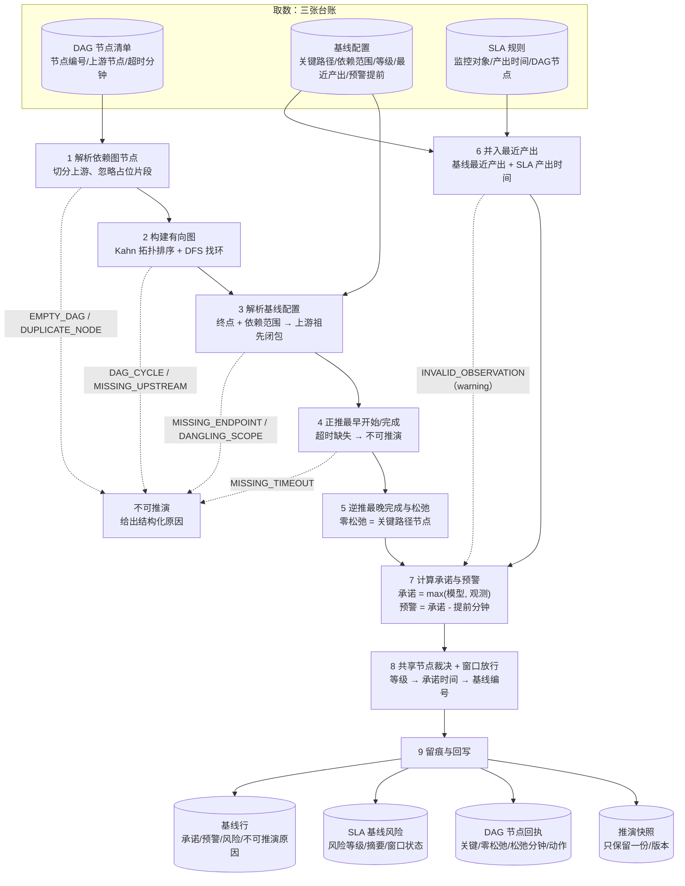

# 基线时间推演：DAG → 基线 → SLA 调用链

> 目标：承诺时间、预警时间不再人工填写，而是从 DAG 依赖关系、关键路径、节点超时和最近产出
> 推导出来；零松弛节点、不可推演原因、共享节点冲突与窗口并发都有明确裁决口径，
> 每次推演都留一份可追溯快照。

## 1. 时间口径与优先级（已定）

| 项目 | 口径 |
| --- | --- |
| 批次 | 一个自然日一个 DAG 批次，从 **06:00** 起算；1 个时间单位 = 1 分钟 |
| 时钟 | 所有时刻是「06:00 + 偏移分钟」的 24 小时制值，同日口径，不跨天 |
| 时区 | Asia/Shanghai（服务端本地时区） |
| 最早完成 | `EFT(n) = max(EFT(上游)) + 超时(n)`，无上游从 0 起算 |
| 最晚完成 | 以**理论完成时间**（不含最近产出校准）为截止逆推：`LFT(终点)=理论完成`，`LST(n)=min(LST(下游)) - 超时(n)` |
| 松弛 | `松弛 = LST - EST`；**松弛为 0 即关键路径节点（零松弛）**，没有额外缓冲系数 |
| 最早可承诺 | `max(理论完成时间, 最近产出观测完成时间)`，承诺不得早于已发生的事实 |
| 预警起点 | `最早可承诺 - 预警提前分钟`，基线未填时默认 **30 分钟** |
| 优先级 | 关键路径等级 `1 > 2 > 3`（数字越小越高）；同级按最早承诺时间升序，再按基线编号升序 |
| 共享节点裁决 | 等级高者在自己该节点上的最晚完成时间为准；低等级基线只能继承**更早**的截止，绝不放宽 |
| 窗口并发 | 同一关键路径 + 时间窗口重叠，只放行优先级最高的一个：低/同级后到直接阻塞，高等级后到可抢占 |

最近产出的取值顺序：基线行「最近产出」（按等级优先，多基线时取优先级最高的那条）
→ SLA 规则「产出时间」（落到显式 `DAG节点` 字段或「监控对象」中能唯一命中的节点编号），
同一节点取**最晚的观测值**。日期缺少 `HH:MM` 的观测只记 warning，不参与推演，也**不会**被当成 00:00。

## 2. 流程图

补充：同一节点被多条基线引用但没有时间冲突时，仍会在快照 `shared_nodes` 里记录
`owners` 与 `critical_path_owner`，便于排障时看清归属。

## 3. 逐步说明（经过的节点与取数环节）

| 步骤 | 输入 | 处理 | 输出 / 失败码 |
| --- | --- | --- | --- |
| 1 | `dag.节点编号/节点名称/上游节点/超时分钟` | 上游按 `,，;；、/` 与空白切分；`无/—/-` 等占位片段忽略并记 warning；编号重复只取第一条 | `Node` 列表；`MISSING_NODE_ID`、`DUPLICATE_NODE` |
| 2 | 上游关系 | Kahn 拓扑排序；剩余节点用 DFS 找环并输出完整环路 | `order`、`cycles`；`DAG_CYCLE`、`SELF_LOOP`、`MISSING_UPSTREAM` |
| 3 | `baseline.关键路径/依赖范围` | 关键路径支持单节点、逗号列表、`A>B>C` 路径写法（末段为终点）；终点与依赖范围一起求上游祖先闭包 | 推演范围 `scope`；`MISSING_ENDPOINT`、`DANGLING_SCOPE` |
| 4 | `dag.超时分钟` | 正推；超时必须是正整数，缺失/非法/非正数一律不可推演 | `EST/EFT`；`MISSING_TIMEOUT` |
| 5 | 正推结果 | 逆推：范围内无下游的节点以理论完成时间为截止 | `LST/LFT`、`slack_min`、`zero_slack_nodes` |
| 6 | `baseline.最近产出`、`sla.产出时间/监控对象/DAG节点` | 按节点合并观测，取最晚；时间缺时刻则只告警 | `observations`；`INVALID_OBSERVATION`、`AMBIGUOUS_SLA_LINK`、`DANGLING_SLA_NODE` |
| 7 | 步骤 4–6 | 承诺 = max(模型完成, 观测完成)；预警 = 承诺 − 提前分钟 | `earliest_commit`、`warn_start`、`headroom_min`、风险摘要 |
| 8 | 各基线结果 | 共享节点裁决（等级 → 承诺 → 编号）后局部重算逆推；窗口重叠时同批排序、跨批先到先得/高等级抢占 | `shared_deadline_constraints`、`window_verdict`、`preempted` |
| 9 | 以上全部 | 落快照（版本键去重）、DAG 回执、SLA 风险、基线行 | `snapshot_id`、`version_key`、`config_hash`、`dag_scope_version` |

## 4. 冲突与并发口径

### 4.1 同一节点被多个基线引用

1. `critical_path_owner`：优先取「零松弛集合包含该节点」的基线；多条时按等级 → 承诺时间 → 编号排序。
2. 低优先级基线会拿到共享节点的 `latest_finish_offset`（来自裁决方自己的最晚完成），
   并以此重算逆推；只收紧、不放宽，因此只会让风险更早暴露。
3. 被压缩后若出现 `松弛 < 0`，风险直接升为「高」，摘要写明是共享节点裁决导致。

### 4.2 关键路径窗口并发

- 窗口定义：`[预警起点, 最早可承诺]`；两条关键路径有交集节点（或相邻边）且区间重叠即为冲突。
- 同一批推演内部：按优先级排序，先到者 `released`，后到者 `blocked`，不落承诺。
- 跨批次并发：`derive` 全程持有进程内锁；已放行的窗口登记在 `window_holds`：
  - 新请求优先级 **低于或同级** → `blocked`，`blocked_by` 指向占用方；
  - 新请求优先级 **更高** → 抢占，旧占用标记 `revoked` 并在新快照 `preempted` 中列出。
- 同一基线重新推演会先作废旧占用，避免历史窗口一直挡着。

## 5. 快照追溯

每份快照包含以下可直接复核的字段：

- `snapshot_id`：整份快照的版本键哈希；
- `generated_at`、`dag_version`（全量 DAG 内容哈希）、`time_basis`（时间口径原文）；
- `items[].version_key`：DAG 范围内版本 + 基线配置哈希 + 时间口径三者合成；
- `items[].config_hash`：基线配置（终点、范围、等级、预警提前、状态、观测原始值）的哈希；
- `items[].context_hash`：共享节点裁决结果 + 并发窗口占用上下文；同样的 DAG 与配置，
  如果窗口已被别的基线占住，结论不同，必须生成新版本而不是命中旧快照；
- `items[].dag_scope_version`；
- `items[].scope_nodes`：本次推演实际经过的节点清单；
- `items[].result.nodes[]`：每节点 `EST/EFT/LST/LFT/松弛/零松弛/观测完成/来源`；
- `items[].result.observed_nodes[]`：每条观测的 `source`（`baseline:BASE-xxxx` / `sla:SLA-xxxx`）与原始值；
- `items[].window_verdict`、`window_key`、`shared_deadline_constraints`。

**去重**：`version_key` 相同的推演只落一份快照；重复请求返回既有快照并标 `deduplicated=true`，
同时回放当时的 `items / released / blocked / attention`，不会再写一次台账。

## 6. 回写与联动

| 目标 | 字段 | 触发 |
| --- | --- | --- |
| 基线行 | `承诺时间/预警时间`（仅 `released`）、`最早可承诺时间/预警起点/模型完成时间/推演关键路径/推演范围/零松弛节点/风险等级/风险摘要/最近产出核对/共享节点裁决/窗口放行/时间推演快照/DAG版本/推演时间` | 每次推演 |
| 基线行（失败） | `推演状态=不可推演`、`不可推演原因[]`、清空旧的建议值 | 每次推演 |
| DAG 节点 | `基线回执`：`baseline/snapshot_id/level/critical/zero_slack/slack_min/EST/EFT/LFT/commit/warn_start/window_status/observed_finish/observed_source`；多条基线共享该节点时按「已放行 > 阻塞 > 不可推演、等级高者优先」只保留一条 | 每次推演 |
| DAG 节点 | `基线回执.last_action/last_action_message/last_action_at/baseline_status` | 基线动作（启用监控/调整基线/关闭基线） |
| SLA 规则 | `基线风险`（基线、快照、等级、摘要、承诺、预警、关键路径、零松弛、观测、窗口是否阻塞）、`风险等级`、`风险重算状态`、`风险快照`、`风险重算时间` | 每次推演 |

## 7. 接口

| 方法 | 路径 | 说明 |
| --- | --- | --- |
| POST | `/api/baseline/derive` | 推演；`baseline_id/baseline_ref` 推单条，`scope_ref/scope_id` 按节点推，`dry_run` 只预演；可传 `now` 固定快照时间 |
| GET | `/api/baseline/snapshots` | 快照列表（倒序，可按基线过滤） |
| GET | `/api/baseline/snapshots/{snapshot_id}` | 单份快照全量追溯 |
| GET | `/api/baseline/derivation/chain` | 调用链、取数/写回环节、不可推演码、时间口径 |
| POST | `/api/baseline/{id}/actions` | 动作 → 回执同步 DAG → 重算 SLA 风险 |
| GET | `/api/dag/receipts` | DAG 节点回执清单（可按基线过滤） |

请求体既支持 `{"values": {...}}`，也支持字段平铺（`{"action": "调整基线"}`）。

## 8. 不可推演判据（均为 error，不按 0 处理）

| 代码 | 触发条件 |
| --- | --- |
| `EMPTY_DAG` | DAG 清单为空 |
| `MISSING_NODE_ID` / `DUPLICATE_NODE` | 节点没有编号 / 编号重复（重复时只警告并取第一条） |
| `MISSING_UPSTREAM` / `SELF_LOOP` | 上游未登记 / 自环 |
| `DAG_CYCLE` | 依赖范围里存在环，消息给出完整环路 |
| `MISSING_ENDPOINT` | 基线没有配置关键路径终点 |
| `DANGLING_SCOPE` | 基线引用的节点不在 DAG 中 |
| `MISSING_TIMEOUT` | 关键路径上节点超时为空/非法/非正数 |
| `MISSING_LEVEL` | 等级不在 1/2/3（仅影响共享节点优先级时会 warning） |
| `INVALID_WARN_LEAD` | 预警提前分钟不是正数 |
| `UNORDERED_SCOPE` | 兜底：依赖范围无法完成拓扑排序 |

`INVALID_OBSERVATION`、`AMBIGUOUS_SLA_LINK`、`DANGLING_SLA_NODE` 是 warning：
只影响观测值的采用，不会让整条基线变成「不可推演」。
